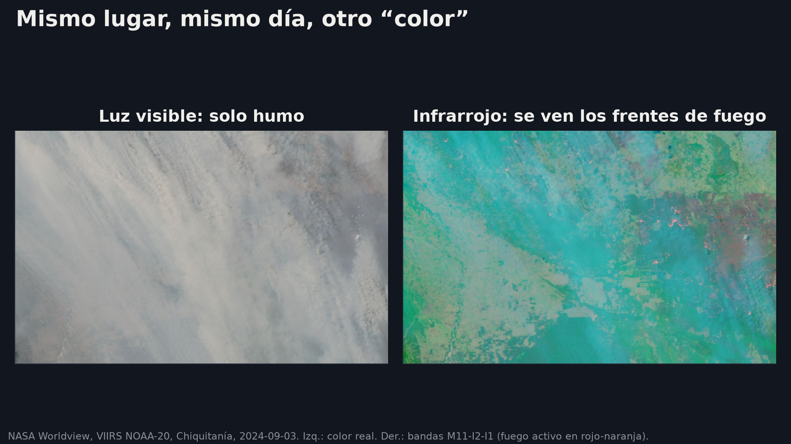
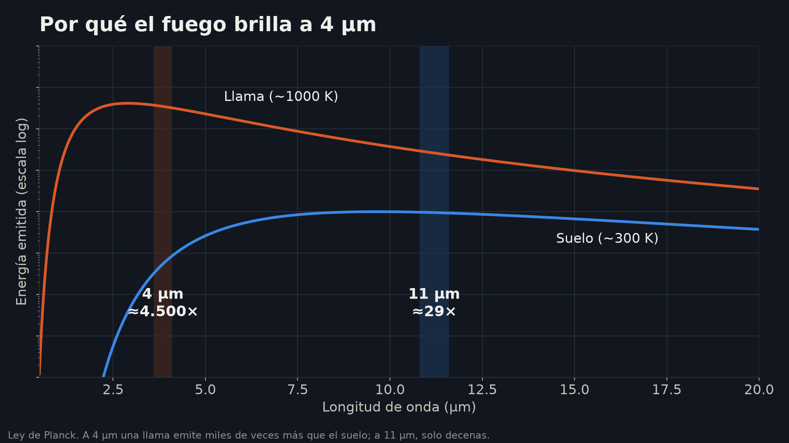
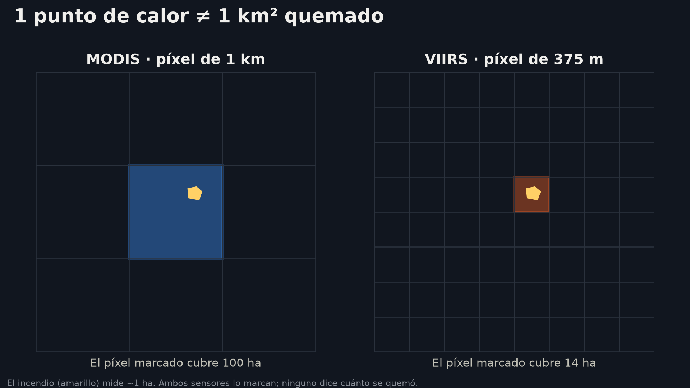
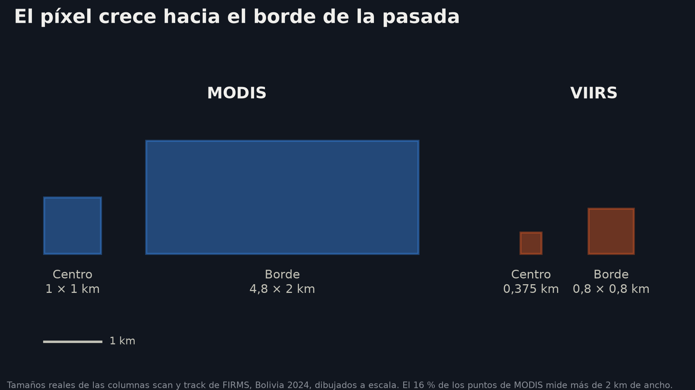
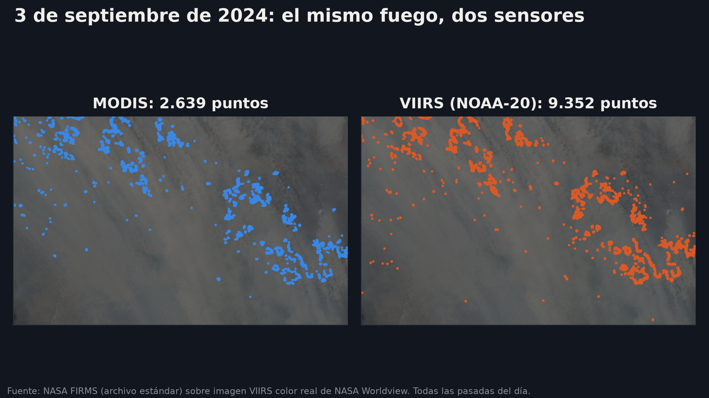
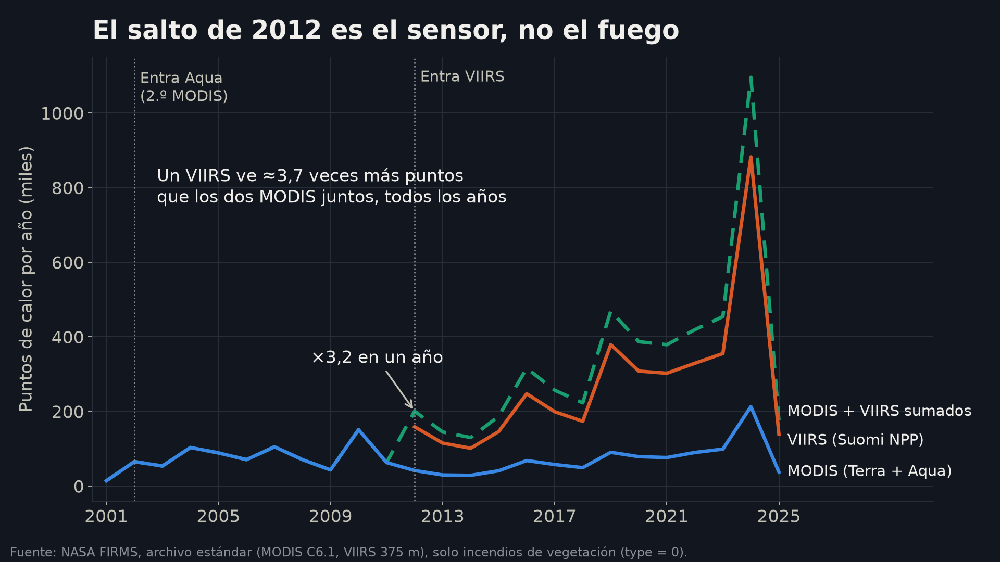
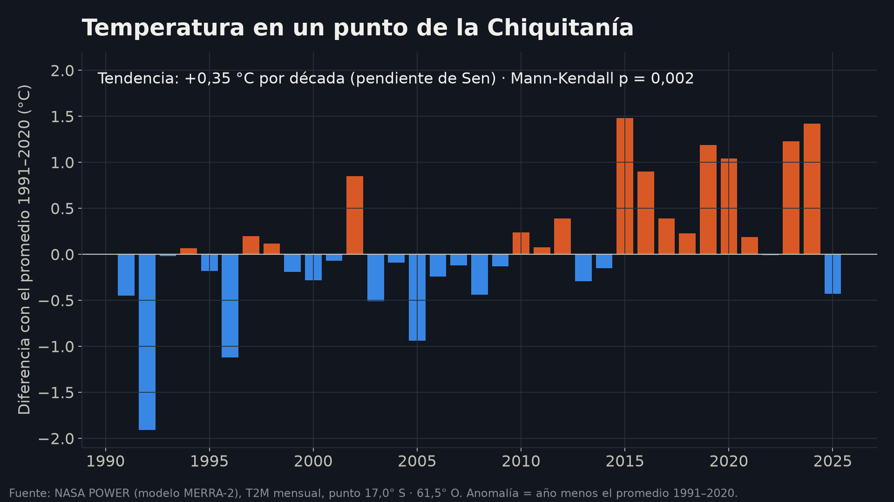

Esta es la guía de la charla **CubeSats aplicados a la observación de la Tierra**. Para entender qué aportan los CubeSats, empieza por los datos que ya usamos todos los días: cómo los satélites de la NASA miden incendios, calor y sequía, con ejemplos de Bolivia. Puedes seguirla mientras escuchas la charla o leerla después, con calma.

La idea central es simple: **los números que vas a ver en una hoja de cálculo o en una API vienen de instrumentos reales que orbitan a entre 700 y 830 km de altura.** Si entiendes cómo se midieron, vas a evitar los errores que más tiempo hacen perder.

Si quieres construir software o herramientas visuales que analicen temperatura, sequías o incendios con datos de la NASA, esta guía es para ti. Vamos a ver dos tareas con detalle:

- **Encontrar qué está cambiando** (temperatura, sequías, incendios), dónde y cuánto, y decir si el cambio es significativo.
- **Unir los puntos de calor de dos instrumentos distintos** en un solo registro coherente.

Si quieres ir directo a la práctica, al final hay un **[notebook listo para Colab](#4-el-llamado-a-la-acción)** que descarga los datos de Bolivia y reproduce todas las gráficas de esta página.

## Una fila de datos

Empecemos por el final del camino. Esto es una fila real del archivo de puntos de calor de la NASA (FIRMS):

```
latitude,longitude,bright_ti4,scan,track,acq_date,acq_time,satellite,instrument,confidence,version,bright_ti5,frp,daynight,type
-16.66248,-59.8208,352.54,0.4,0.44,2024-09-03,1712,N20,VIIRS,n,2,318.19,29.56,D,0
```

Traducido: el 3 de septiembre de 2024, a las 17:12 UTC (13:12 en Bolivia), el instrumento VIIRS del satélite NOAA-20 vio un píxel muy caliente en la Chiquitanía.

- `bright_ti4` es qué tan caliente se ve el píxel, en kelvin.
- `frp` es qué tan fuerte arde el fuego, en megavatios.
- `confidence` es qué tan seguro está el algoritmo (`n` = nominal).
- `type = 0` significa que es un incendio de vegetación.

El resto de la página explica de dónde sale cada uno de esos números.

## 1. La revolución de la observación de la Tierra

Los incendios que vas a analizar los miden dos instrumentos de la NASA:

- **MODIS**, en Terra (desde 2000) y Aqua (desde 2002). Píxel de 1 km para incendios.
- **VIIRS**, en Suomi NPP (desde 2012), NOAA-20 y NOAA-21. Píxel de 375 m.

Son satélites grandes: Terra, lanzado en 1999, pesa unas 5 toneladas. Están muy bien calibrados y suman más de 20 años de datos, y por eso son la referencia.

Y hay noticias de este mismo mes. **Suomi NPP dejó de entregar datos nuevos el 2 de noviembre de 2026**, y **MODIS está en sus últimos meses**: según la NASA, Terra y Aqua empezarán a apagarse entre fines de 2026 e inicios de 2027. Los datos históricos siguen disponibles, pero el registro de 25 años ahora depende de unir bien ambos sensores. Unirlos bien da para un gran proyecto.

### ¿Y los CubeSats?

Los datos que vamos a usar vienen de satélites grandes. Los pequeños cumplen otro papel.

Un **CubeSat** es un satélite construido con un estándar de cubos de 10 cm (cada cubo, o "1U", pesa hasta 2 kg). Se combinan en 3U, 6U o 12U, se lanzan en grupo como pasajeros de otros cohetes y los pueden construir universidades y países que recién empiezan. Bolivia también está construyendo el suyo.

Lo que aportan es frecuencia. En órbita baja, un satélite da una vuelta a la Tierra en unos 90 minutos, pero pasa sobre el mismo lugar solo una o dos veces al día. Con muchos satélites pequeños, la revisita puede llegar a ser diaria, o de dos veces al día. **Observar seguido durante años es lo que permite detectar tendencias.**

#### CubeSats que ya observan la Tierra

- **PlanetScope (Planet).** Cientos de CubeSats de 3U que fotografían casi toda la tierra firme casi cada día, en visible e infrarrojo cercano, con píxeles de unos 3 m. No tienen banda térmica, así que no ven el calor del fuego. ([Planet](https://docs.planet.com/data/imagery/planetscope/))
- **OroraTech (Alemania).** Ocho CubeSats de 8U lanzados en 2025 que miden en infrarrojo medio y térmico, con píxeles de unos 200 m. Pasan de madrugada y a media tarde, detectan el fuego a bordo y bajan solo los focos. ([NASA CSDA](https://science.nasa.gov/earth-science/csda/vendor-ororatech/))
- **Φsat-1 (ESA, 2020).** Un CubeSat de 6U que, según la ESA, fue el primer satélite de observación de la Tierra con IA a bordo: descartaba las imágenes nubladas antes de enviarlas. ([eoPortal](https://www.eoportal.org/satellite-missions/phisat-1))

Suman frecuencia y horarios nuevos, pero no reemplazan a MODIS ni a VIIRS: a estos satélites se los evalúa comparándolos con VIIRS. Además, sus datos son comerciales o experimentales; para empezar, los datos abiertos de la NASA siguen siendo el punto de partida.

## 2. De la cámara al dato

Un satélite de observación mide cuánta energía llega en distintos "colores" de luz, la mayoría invisibles para el ojo humano:

- **Luz reflejada** (visible e infrarrojo cercano): fotos, vegetación.
- **Infrarrojo medio** (alrededor de 4 µm): fuego.
- **Infrarrojo térmico** (alrededor de 11 µm): temperatura de la superficie.

La mejor forma de entenderlo es ver el mismo lugar el mismo día:



En color real solo se ve humo. En infrarrojo aparecen los frentes de fuego.

¿Por qué el fuego "brilla" tanto en el infrarrojo medio? Piensa en un fierro al rojo: mientras más caliente está, más brilla, y el color de su brillo cambia. Una llama a unos 1000 K emite alrededor de **4.500 veces más energía que el suelo a 4 µm**, pero solo unas 29 veces más a 11 µm.



El algoritmo aprovecha ese contraste. Compara las dos bandas y compara cada píxel con sus vecinos; si destaca mucho, lo marca como punto de calor. Por eso detecta fuegos mucho más pequeños que el píxel: MODIS ve de forma habitual incendios de unos 1.000 m², y, en condiciones excepcionales, de hasta unos 50 m².

**¿Y en un CubeSat?** Un CubeSat de incendios mira en la misma ventana del infrarrojo medio que MODIS y VIIRS: la física es la misma. Lo que cambia es el tamaño. Con una óptica chica y un detector sin enfriar puede ganar detalle, pero a cambio de una franja más angosta y menos precisión en la temperatura. Diseñar un CubeSat es elegir esos compromisos.

Eso tiene una consecuencia importante: **un punto de calor no es un incendio de 1 km².**



Un punto dice "en este píxel había algo muy caliente cuando pasó el satélite". No dice cuánto se quemó. Si necesitas hectáreas, usa el producto de **área quemada** (MCD64A1), no los puntos. Para comparar intensidad, el `frp` sirve más que contar puntos.

### Qué tan grande es un píxel

La **resolución espacial** (o GSD, *ground sample distance*) es cuánto terreno cubre un píxel. Depende de la altura del satélite y del ángulo que ve cada detector. Los números conocidos, 1 km para MODIS y 375 m para VIIRS, valen solo para el centro de la pasada, justo debajo del satélite.

Hacia los bordes de la franja, el satélite mira en diagonal y el píxel se estira. FIRMS trae el tamaño real de cada píxel en las columnas `scan` (ancho) y `track` (largo). La fila del inicio mide 0,40 × 0,44 km.



Dos consecuencias prácticas:

- **La coordenada es el centro del píxel, no el fuego.** El incendio puede estar en cualquier parte del píxel. Para cruzar MODIS con VIIRS, compara con una tolerancia de alrededor de 1 km o agrupa en una cuadrícula; no busques coordenadas idénticas.
- **En el borde, MODIS puede contar dos veces el mismo fuego**, porque sus píxeles se solapan. En Bolivia, en 2024, el 16 % de los puntos de MODIS tiene más de 2 km de ancho. Si quieres comparar con cuidado, filtra los píxeles grandes o trabaja en celdas.

### El viaje del dato

Entre el sensor y tu CSV hay varias etapas:

1. El satélite guarda las mediciones y las baja a estaciones terrenas. Las que están cerca de los polos, como Svalbard, lo ven en casi cada órbita.
2. **L0**: los números crudos del detector.
3. **L1**: la "foto" calibrada, en unidades físicas, y ubicada en el mapa.
4. **L2**: la foto convertida en una variable, por ejemplo "hay fuego aquí". Eso es FIRMS.
5. **L3**: todo ordenado en una cuadrícula por día o por mes, listo para graficar.

Cada columna de la fila del inicio nace en una de esas etapas. La fecha y la hora vienen del reloj del satélite. La latitud y la longitud salen de la geolocalización de L1: dónde estaba el satélite y hacia dónde miraba. `bright_ti4` sale de la calibración de L1. `confidence`, `frp` y `type` los calcula el algoritmo de L2. Ahí se juntan el hardware y el software.

Ustedes empiezan en L2 o L3. Un detalle clave: FIRMS publica datos **casi en tiempo real** (unas 3 horas después del paso) y meses después un **archivo estándar** reprocesado. **Para tendencias usen el archivo estándar.**

**¿Y en un CubeSat?** Recorre exactamente el mismo camino: mide, guarda, baja a una estación terrena y pasa por L0, L1 y L2. La diferencia es que todo es más chico: menos memoria, menos tiempo de contacto con la estación, menos ancho de banda. Por eso cada vez más satélites pequeños procesan a bordo y bajan solo lo útil: el punto de calor, no la imagen completa.

Ojo con las fechas: el archivo estándar por país llega hasta el 31 de diciembre de 2025. La temporada de incendios de 2026 solo está en los datos casi en tiempo real, que se piden por la API con una clave gratuita. Si los suman a la serie, márquenlos como provisionales; si no, terminen la serie en 2025.

## 3. Lo difícil de los datos espaciales

### Lo que el satélite no ve

Hay dos errores posibles, y conviene pensarlos por separado.

**Fuego sin punto** (el satélite no lo ve):

- **Nubes.** El infrarrojo no las atraviesa. El humo, en cambio, deja pasar bastante el infrarrojo medio; por eso se ven fuegos bajo el humo.
- **No pasaba a esa hora.** El fuego tiene un ciclo diario, con su pico por la tarde. Terra pasa a media mañana; Aqua y VIIRS, a primera hora de la tarde. Por eso Terra ve menos fuego que Aqua el mismo día.
- **Fuego chico, frío o bajo los árboles.** Quemas pequeñas, fuegos sin llama o fuegos bajo el dosel pueden no destacar lo suficiente en el píxel.

**Punto sin fuego** (el satélite ve algo que no es un incendio):

- **Fuentes calientes fijas**, como industrias, mecheros de gas o volcanes, y de día, reflejos del sol en techos o agua. En el archivo estándar, la columna `type` las separa: `0` = vegetación, `1` = volcán, `2` = otra fuente fija en tierra, `3` = en el mar. Los datos casi en tiempo real no la traen.

Dos detalles más. De noche la detección es más sensible, pero hay menos fuego activo: analiza día y noche por separado (columna `daynight`). Y la hora de paso de Terra se está corriendo: cada año pasa un poco más temprano, más lejos del pico de la tarde. Una serie hecha solo con Terra puede mostrar menos fuego aunque nada haya cambiado en el suelo. Para tendencias, separa Terra y Aqua (columna `satellite`) y compáralas.

Si vas a buscar tendencias, esto importa mucho. Los puntos de FIRMS no te dicen si un día sin puntos estuvo despejado y sin fuego, o nublado. **Un día sin puntos no es un cero.** Si necesitas esa diferencia, la máscara de incendios L2 clasifica cada píxel como nube, agua, suelo sin fuego o fuego.

### Dos instrumentos, dos maneras de ver

MODIS y VIIRS usan la misma física, pero distinta resolución, distintos algoritmos y distintas horas de paso. Mira la misma zona, el mismo día:



| | MODIS | VIIRS |
|---|---|---|
| Píxel para incendios | 1 km | 375 m |
| Satélites | Terra (desde 2000) · Aqua (desde 2002) | Suomi NPP (2012–2026) · NOAA-20 · NOAA-21 |
| Hora de paso | Terra ~10:30 (cada vez más temprano) · Aqua ~13:30 (cada vez más tarde) | ~13:30 |
| Confianza | 0 a 100 | baja / nominal / alta |

En Bolivia, entre 2012 y 2025, **un solo VIIRS (Suomi NPP) registró unas 3,7 veces más puntos que los dos MODIS juntos.** Pero más puntos no es más fuego. El píxel de VIIRS es unas 7 veces más chico en área: ve fuegos más pequeños y además parte un mismo frente en varios puntos. Si en vez de contar puntos cuentas "¿hubo fuego en esta celda de 0,25° este día?", la diferencia baja a unas **2 veces**. El notebook lo calcula en la sección 5b.

Para comparar los dos sensores, la mejor pareja es **Aqua con VIIRS**: pasan casi a la misma hora. Y ojo: ninguna de las dos escalas de confianza es una probabilidad, y no se pueden igualar con un mismo umbral sin pensarlo.

### Un cambio de sensor parece una tendencia

Esta es la trampa más importante al trabajar con estos datos. Si sumas los puntos de MODIS y VIIRS, en 2012 "aparece" muchísimo más fuego en Bolivia:



No es más fuego: es la entrada de un sensor que ve fuegos más pequeños y en píxeles más chicos. Lo mismo, en pequeño, pasa en 2002 con la entrada de Aqua. La buena noticia es que la razón entre sensores es bastante estable de un año a otro (entre 3,5 y 4,2), así que se pueden armonizar.

Ideas para empezar:

1. **Calibrar con los años en que funcionan ambos** (2012–2025 en el archivo estándar). Lo mejor es comparar pasadas casi simultáneas: Aqua y VIIRS cruzan a la misma hora.
2. **Usar píxeles del centro de la franja** y separar día y noche.
3. **Llevar ambos sensores a una cuadrícula común** (por ejemplo, celdas de 0,25°, unos 25 km) y comparar "hubo fuego ese día: sí o no" en lugar de contar puntos.
4. **Calcular factores por región y por mes** (Chaco, Chiquitanía, Amazonía).
5. **Validar con años que no usaste para calibrar.** En el notebook, un factor por mes calculado con 2012–2019 predice el total de 2020–2025 con un error de +3,8 %.
6. **No sumar detecciones directamente, y documentar el método.** Un valor armonizado es una estimación, no una medición.

**¿Y en un CubeSat?** Una constelación son decenas de sensores pequeños, cada uno un poco distinto. Si unir dos sensores ya es difícil, imagina decenas. Planet, por ejemplo, armoniza sus propios CubeSats contra Landsat, Sentinel-2, MODIS y VIIRS. Lo que aprendes armonizando MODIS y VIIRS es exactamente lo que hace falta para aprovechar las constelaciones de CubeSats.

### No todo es fuego

No todo es fuego: también cambian la temperatura y la sequía. Este es un ejemplo con temperatura:



Cada barra es un año menos el promedio de 1991–2020. A esa diferencia se le llama **anomalía**: quita lo "normal" y deja ver el cambio. La tendencia es de **+0,35 °C por década**, y la prueba de Mann-Kendall da **p = 0,002**: es muy poco probable que sea solo azar. Eso es lo que hace fuerte a un análisis de tendencias: cuánto cambia y si el cambio es significativo.

Una pregunta que conviene hacerse siempre: **¿esto lo midió un satélite o lo calculó un modelo?** Esta serie viene de NASA POWER, que usa un modelo (el reanálisis MERRA-2) para combinar millones de mediciones de satélites, estaciones y globos, y estimar la temperatura del aire sin huecos. Es cómodo y largo, pero es una estimación. Lo que un satélite sí mide es la temperatura de la **superficie** (MODIS LST), que no es la del aire. Y ahí vuelve la trampa de la órbita: como Terra pasa cada vez más temprano, su temperatura de superficie puede mostrar un enfriamiento que no existe.

Un detalle más: esta serie es un solo punto de unos 50 km. Para hablar de toda la Chiquitanía, promedia varios puntos o trabaja con un mapa.

Algunas variables útiles para Bolivia:

| Pregunta | Producto de la NASA | Desde |
|---|---|---|
| ¿Hace más calor? | Temperatura de superficie MODIS (MOD11C3) | 2000 |
| ¿Llueve menos? | GPM IMERG | 2000 |
| ¿Está más seco el suelo? | SMAP | 2015 (serie corta) |
| ¿Está más estresada la vegetación? | NDVI de MODIS (MOD13) | 2000 |
| Clima en un punto, rápido | NASA POWER (modelo) | 1981 |
| Temperatura y humedad del aire, medidas | AIRS, en el satélite Aqua | 2002 |
| Humedad del suelo y evaporación | GLDAS (modelo) | 2000 |
| ¿Hay más incendios? | FIRMS (archivo estándar) | 2000 |

Una **sequía** no es una sola variable: es menos lluvia, suelo más seco, vegetación estresada y más calor. Un buen proyecto cruza dos o tres de ellas.

## 4. El llamado a la acción

El hardware ya hizo su parte: capturó el dato y lo bajó a una estación terrena. Ahora les toca a ustedes.

### ¿Qué pueden construir?

- **Unir dos sensores.** MODIS y VIIRS en un solo registro de quema, todo desde FIRMS. Ideal para equipos fuertes en web y visualización. *Ejemplo:* un calendario semanal de quema por municipio, con "hubo fuego sí o no", calibrado con el periodo en que funcionan ambos sensores.
- **Encontrar qué está cambiando.** Temperatura, sequía o fuego a lo largo de los años, con varias variables y algo de estadística. *Ejemplo:* "¿se adelantó la temporada de incendios en la Chiquitanía?", con anomalías mensuales de FIRMS y lluvia de IMERG. Elige variables, bájalas para una región, grafica una serie larga y prueba si la tendencia es significativa (por ejemplo, con Mann-Kendall). **Gráfica, tendencia y significancia: las tres.** Y una tendencia que no resulta significativa también es un resultado válido.

Un buen equipo necesita a alguien que programe, a alguien que entienda el problema (biología, agronomía, gestión de riesgos) y a alguien que cuente la historia. **No necesitas programar para empezar:** Giovanni y Worldview hacen gráficas y mapas desde el navegador.

### El notebook

Preparé un notebook en español que reproduce las gráficas de esta página con datos reales de Bolivia:

- **[Abrir en Google Colab](https://colab.research.google.com/github/ChristianConchari/christianconchari.github.io/blob/master/public/notebooks/firms_bolivia_starter.ipynb)**
- [Descargar el notebook (.ipynb)](/notebooks/firms_bolivia_starter.ipynb)

Qué hace, paso a paso:

1. Descarga los puntos de calor de Bolivia **sin cuenta ni clave**, con los archivos anuales por país de FIRMS.
2. Explica cada columna y muestra la temporada de incendios.
3. Muestra el salto de 2012.
4. Hace una primera armonización con un factor por mes: calibra con 2012–2019 y valida con 2020–2025.
5. Compara conteos de puntos con una cuadrícula de "hubo fuego sí o no".
6. Aplica una prueba de tendencia (Mann-Kendall estacional con pendiente de Sen).
7. Termina con un ejemplo de NASA POWER.

Tómalo como punto de partida, no como solución.

### Herramientas

Todas son herramientas oficiales y gratuitas de la NASA, agrupadas por lo que quieres hacer.

**Para ver:**

- **[FIRMS](https://firms.modaps.eosdis.nasa.gov)**: el mapa de puntos de calor. Para datos recientes usa las capas de NOAA-20 y NOAA-21: Suomi NPP ya no se actualiza.
- **[Worldview](https://worldview.earthdata.nasa.gov)**: imágenes satelitales del día, para ver y entender.

**Para graficar sin programar:**

- **[Giovanni](https://giovanni.gsfc.nasa.gov)**: series de tiempo y mapas desde el navegador. Tiene casi todas las variables para buscar tendencias: MERRA-2, GLDAS, AIRS, IMERG y MODIS.

**Para descargar y programar:**

- **Archivos anuales de FIRMS por país**: Bolivia entera, 2000–2025, sin cuenta ni clave. Es lo que usa el notebook. Para otras zonas está *Archive Download* (llega por correo y puede tardar horas), y para lo reciente, la API con clave gratuita (MAP_KEY), que devuelve pocos días por consulta.
- **[Earthdata Search](https://search.earthdata.nasa.gov)** y **[AppEEARS](https://appeears.earthdatacloud.nasa.gov)**: descargar y recortar productos por zona y fecha.
- **[NASA POWER](https://power.larc.nasa.gov)**: clima en un punto, con una API sin clave.
- En Python: `earthaccess` (para descargar de Earthdata), `pandas`, `xarray` y `pymannkendall`.

Giovanni, Earthdata Search, AppEEARS y `earthaccess` piden una cuenta gratuita de [Earthdata Login](https://urs.earthdata.nasa.gov). FIRMS por país y NASA POWER no piden nada.

### Seis consejos para empezar

1. **Una pregunta, una región y una variable para empezar.** "¿Aumentó la temporada de incendios en la Chiquitanía entre 2001 y 2025?" funciona. "Analizar el cambio climático" no.
2. **Quita la temporada.** Trabaja con anomalías. En Bolivia la temporada seca va de julio a octubre, con el pico de incendios en agosto y septiembre.
3. **Antes de decir "aumentó", revisa si cambió el sensor o la hora de paso.**
4. **Un día sin puntos no es un cero.**
5. **Tendencia y significancia.** Para la significancia, Mann-Kendall estacional con la pendiente de Sen, como en el notebook; si pruebas muchas regiones a la vez, corrige por comparaciones múltiples. Y si la tendencia no resulta significativa, también es un resultado.
6. **Escribe tus supuestos y haz una gráfica que cuente la historia.** Un método honesto convence más que un número espectacular, y una sola gráfica bien hecha vale más que diez.

### Para empezar hoy

- [ ] Crear tu cuenta gratuita en [Earthdata Login](https://urs.earthdata.nasa.gov).
- [ ] Abrir el notebook en Colab y correrlo una vez.
- [ ] Escribir tu pregunta en una sola línea.
- [ ] Pedir tu MAP_KEY de FIRMS, solo si vas a usar datos de 2026.

Los satélites grandes nos dieron 25 años de datos; los CubeSats nos van a dar más ojos, y más seguido. Para aprovecharlos hace falta gente que sepa leer bien los datos. Ahora te toca a ti descubrir qué está cambiando.

Si quieres seguir conversando sobre satélites, datos o tu proyecto, conectemos en **[LinkedIn](https://www.linkedin.com/in/chrisconchari/)**.

---

**Fuentes de datos:** NASA FIRMS (MODIS Collection 6.1 y VIIRS 375 m, archivo estándar), NASA Worldview (imágenes VIIRS NOAA-20 y MODIS Terra) y NASA POWER (temperatura del aire a 2 m, modelo MERRA-2).

**Sobre el estado de los satélites:**

- [Earthdata — Transición desde Suomi NPP para usuarios de FIRMS](https://www.earthdata.nasa.gov/news/blog/transitioning-from-suomi-npp-viirs-omps-what-firms-users-need-know)
- [Earthdata — Transición de MODIS a VIIRS](https://www.earthdata.nasa.gov/data/alerts-outages/transition-from-modis-viirs)
- [LAADS — Transición de MODIS a VIIRS](https://ladsweb.modaps.eosdis.nasa.gov/learn/modis-to-viirs-transition/)
- [FIRMS FAQ](https://www.earthdata.nasa.gov/data/tools/firms/faq)
